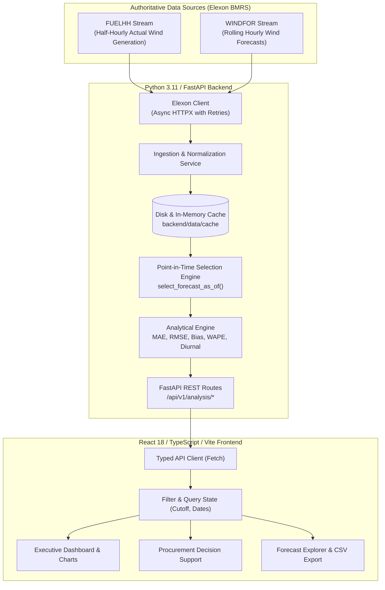

# Gridbricks UK Wind Forecast & Day-Ahead Procurement Intelligence Platform

[](https://github.com/gridbricks-anonymous/uk-wind-forecast-analytics/actions)
[](https://www.python.org/)
[](https://fastapi.tiangolo.com/)
[](https://reactjs.org/)
[](https://www.typescriptlang.org/)
[](https://tailwindcss.com/)
[]()

> A production-quality energy analytics platform built for an electricity utility's day-ahead power procurement team in Great Britain. Evaluates point-in-time national wind generation forecasts (`WINDFOR`) against official Elexon settlement actuals (`FUELHH`) across all 744 hours of January 2026 without lookahead bias.

---

## Table of Contents
1. [Product Overview & Business Problem](#1-product-overview--business-problem)
2. [Key Features](#2-key-features)
3. [System Architecture](#3-system-architecture)
4. [Repository Structure](#4-repository-structure)
5. [Technology Stack & Rationale](#5-technology-stack--rationale)
6. [Elexon Datasets & Schema Alignment](#6-elexon-datasets--schema-alignment)
7. [Forecast Selection Methodology & Cutoff Assumptions](#7-forecast-selection-methodology--cutoff-assumptions)
8. [Accuracy Metric Definitions](#8-accuracy-metric-definitions)
9. [Missing Data & Timestamp Normalization](#9-missing-data--timestamp-normalization)
10. [Local Installation & Setup](#10-local-installation--setup)
11. [Docker & Containerized Execution](#11-docker--containerized-execution)
12. [Environment Configuration](#12-environment-configuration)
13. [Automated Test Suites & Quality Verification](#13-automated-test-suites--quality-verification)
14. [Backend API Documentation](#14-backend-api-documentation)
15. [Deployment Architecture](#15-deployment-architecture)
16. [Procurement Boundary Guardrails & Known Limitations](#16-procurement-boundary-guardrails--known-limitations)
17. [Engineering Decisions & Trade-Offs](#17-engineering-decisions--trade-offs)
18. [AI Tools Disclosure](#18-ai-tools-disclosure)
19. [Video Demo Plan](#19-video-demo-plan)

---

## 1. Product Overview & Business Problem

In the Great Britain electricity market, energy suppliers and utilities must balance power demand with generation. Day-ahead procurement decisions are finalized **one day before physical delivery** (specifically at the Day-Ahead Auction order book gate closure at **11:00 GMT on D-1** for EPEX SPOT and Nord Pool).

Renewable generation—particularly wind—is intermittent and subject to significant forecast error. When making day-ahead trading decisions, a utility procurement team faces two critical risks:
- **Overforecasting ($F > A$):** The forecast predicts more wind than actually materializes. The utility under-procures thermal/contracted energy day-ahead and is left with a **short position**, forcing expensive last-minute balancing actions or cash-out exposure to National Grid ESO System Buy Prices (SBP).
- **Underforecasting ($F < A$):** The forecast predicts less wind than actually materializes. The utility over-procures day-ahead and is left with a **long position**, resulting in excess power spilled or cashed out at discounted System Sell Prices (SSP).

### The Core Challenge Requirement
A forecast published *after* the decision cutoff must never be presented as information that was available to the buyer at that decision time. This application enforces **strict point-in-time forecast selection**, ensuring complete historical analytical validity.

---

## 2. Key Features

- **Executive Analytics Dashboard:** Dynamic computation of MAE, RMSE, Mean Bias, WAPE, and Coverage across all 744 hours of January 2026.
- **Configurable Point-in-Time Decision Cutoffs:**
  - `Day-Ahead 11:00 UK Time` (Default: EPEX SPOT / Nord Pool GB Auction gate closure)
  - `Day-Ahead 12:00 UK Time` (European standard noon locking cutoff)
  - `Day-Ahead 17:00 UK Time` (End of business day prior to delivery)
  - `Day-Ahead 23:00 UK Time` (Midnight prior to delivery)
  - `Rolling Cutoffs` (24h, 12h, 6h, 2h before delivery interval start)
- **Interactive Multi-Horizon Charts (Recharts):**
  - **Actual vs. Forecast Time Series:** Synchronized tooltip, area curves, and interactive zoom Brush slider spanning 744 hours.
  - **Signed Error Bar Chart:** Clear zero baseline with color-coded error direction (amber = overforecast, cyan = underforecast).
  - **Error Distribution Histogram:** 9 standard power industry bins from $<-4\text{ GW}$ to $>+4\text{ GW}$ with central accurate band.
  - **Daily Performance Breakdown:** Daily MAE bar chart and signed bias trendline.
  - **24-Hour Diurnal Profile:** Hour-of-day accuracy (00:00 to 23:00 UTC) identifying intraday ramp errors.
- **Day-Ahead Procurement Decision Support:**
  - Physical exposure volume quantification (Total MWh overforecast vs underforecast).
  - Clear explanations of cash-out implications and balancing mechanism risks.
  - Transparent analytical guardrails.
- **Forecast Explorer (Interval Audit Table):**
  - Searchable, sortable, paginated audit table with publication timestamps, forecast age at cutoff, lead times, and status badges.
  - Instant CSV export of the full matched dataset.
- **In-App Methodology Panel:** Accessible modal explaining Elexon endpoints, metric mathematics, interval aggregation, and market rules.

---

## 3. System Architecture



---

## 4. Repository Structure

```
gridbricks-wind-forecast-analytics/
├── backend/
│   ├── app/
│   │   ├── __init__.py
│   │   ├── main.py                  # FastAPI entry point, CORS, lifespan, middleware
│   │   ├── api/
│   │   │   ├── __init__.py
│   │   │   └── routes.py            # Versioned API routes (/api/v1/*)
│   │   ├── core/
│   │   │   ├── __init__.py
│   │   │   ├── config.py            # Pydantic BaseSettings environment configuration
│   │   │   └── logging.py           # Structured application logger
│   │   ├── repositories/
│   │   │   ├── __init__.py
│   │   │   └── data_store.py        # Cache persistence layer (JSON/memory)
│   │   ├── schemas/
│   │   │   ├── __init__.py
│   │   │   ├── common.py            # Cutoff presets, health, metadata schemas
│   │   │   ├── forecast.py          # ForecastRecord, ActualRecord, MatchedInterval
│   │   │   └── analytics.py         # SummaryMetrics, Timeseries, Daily, Diurnal
│   │   └── services/
│   │       ├── __init__.py
│   │       ├── elexon_client.py     # Async HTTPX client for Elexon BMRS API
│   │       ├── forecast_selection.py # Point-in-time selection (select_forecast_as_of)
│   │       ├── ingestion.py         # Stream chunking, deduplication, interval matching
│   │       └── analysis.py          # MAE, RMSE, Bias, WAPE, histograms, diurnal
│   ├── data/
│   │   └── cache/                   # Pre-cached January 2026 Elexon data (sub-50ms query)
│   │       ├── fuelhh_wind_actuals.json
│   │       └── windfor_forecasts.json
│   ├── tests/
│   │   ├── test_forecast_selection.py # Unit tests for point-in-time logic and cutoffs
│   │   ├── test_analysis.py          # Mathematical validation of MAE, RMSE, WAPE
│   │   └── test_api.py               # Integration tests for all REST endpoints
│   ├── Dockerfile                   # Python 3.11-slim production container
│   └── requirements.txt             # Pinned backend dependencies
├── frontend/
│   ├── src/
│   │   ├── components/
│   │   │   ├── analytics/
│   │   │   │   └── SummaryCards.tsx           # KPI metric cards
│   │   │   ├── charts/
│   │   │   │   ├── ActualVsForecastChart.tsx  # Actual vs forecast time-series + brush
│   │   │   │   ├── DailySummaryChart.tsx      # Daily MAE and bias bars
│   │   │   │   ├── DiurnalChart.tsx           # 24-hour hour-of-day accuracy profile
│   │   │   │   ├── ErrorChart.tsx             # Signed error bars with zero baseline
│   │   │   │   └── ErrorDistributionChart.tsx # 9-bin histogram of error distribution
│   │   │   ├── controls/
│   │   │   │   └── FilterBar.tsx              # Date picker, cutoff selector, CSV export
│   │   │   ├── explorer/
│   │   │   │   └── ForecastTable.tsx          # Audit table with pagination & sorting
│   │   │   ├── layout/
│   │   │   │   └── Header.tsx                 # Enterprise navbar with live status badges
│   │   │   ├── methodology/
│   │   │   │   └── MethodologyModal.tsx       # In-app methodology documentation
│   │   │   └── procurement/
│   │   │       └── ProcurementDecisionSupport.tsx # Volume risks & regulatory notice
│   │   ├── services/
│   │   │   └── api.ts                         # Typed API client
│   │   ├── test/                              # Vitest component test suites
│   │   │   ├── FilterBar.test.tsx
│   │   │   ├── ProcurementDecisionSupport.test.tsx
│   │   │   ├── SummaryCards.test.tsx
│   │   │   └── setup.ts
│   │   ├── types/
│   │   │   └── index.ts                       # TypeScript interfaces
│   │   ├── utils/
│   │   │   └── format.ts                      # Deterministic en-GB number formatting
│   │   ├── App.tsx                            # Root application view & tab state
│   │   ├── index.css                          # Tailwind CSS & custom scrollbars
│   │   └── main.tsx                           # React 18 DOM mount
│   ├── Dockerfile                             # Multi-stage Node 20 + Nginx Alpine
│   ├── nginx.conf                             # Production Nginx reverse-proxy config
│   ├── package.json
│   ├── tsconfig.json
│   └── vite.config.ts
├── demo/
│   └── RECORDING_PLAN_AND_SCRIPT.md          # 10-minute 2-part video recording plan
├── docker-compose.yml                         # Orchestration for frontend & backend
├── .env.example                               # Annotated environment template
├── .gitignore
├── .dockerignore
└── pytest.ini                                 # Pytest configuration
```

---

## 5. Technology Stack & Rationale

| Layer | Technology | Version | Rationale |
|---|---|---|---|
| **Frontend Framework** | React + TypeScript | 18.3.1 / 5.6.3 | Type-safe, component-driven UI for financial and data-dense dashboards. |
| **Build Tool** | Vite | 5.4.10 | Instant Hot Module Replacement (HMR) and optimized Rollup chunking. |
| **Styling** | Tailwind CSS | 3.4.15 | Dense, accessible design system matching enterprise energy trading desks. |
| **Data Visualization** | Recharts | 2.13.3 | Highly performant declarative SVG charting with custom tooltips and brush zoom. |
| **Frontend Testing** | Vitest + Testing Library | 2.1.5 | Fast in-memory component and interaction testing. |
| **Backend Framework** | FastAPI | 0.115.4 | High-performance asynchronous REST API with automatic OpenAPI documentation. |
| **Validation** | Pydantic v2 | 2.9.2 | Strict typed request and response schema validation with sub-millisecond serialization. |
| **Data Analysis** | Pandas & NumPy | 2.2.3 / 2.3.1 | Authoritative vector math for MAE, RMSE, WAPE, and interval matching. |
| **HTTP Client** | HTTPX | 0.27.2 | Fully asynchronous HTTP client with bounded retries and exponential backoff. |
| **Backend Testing** | Pytest + Pytest-Asyncio | 8.3.3 / 0.24.0 | Comprehensive unit and integration test framework. |
| **Containerization** | Docker & Compose | Multi-stage | Reproducible local development and production deployment. |

---

## 6. Elexon Datasets & Schema Alignment

### Authoritative Endpoints
1. **Actual Generation:** Elexon BMRS `FUELHH` Stream  
   `https://data.elexon.co.uk/bmrs/api/v1/datasets/FUELHH/stream`
   - Filter: `fuelType == 'WIND'`
   - Fields used: `startTime` (interval start), `publishTime`, `settlementDate`, `settlementPeriod` (1–48), `generation` (MW).
2. **Forecast Generation:** Elexon BMRS `WINDFOR` Stream  
   `https://data.elexon.co.uk/bmrs/api/v1/datasets/WINDFOR/stream`
   - Fields used: `startTime` (delivery interval start), `publishTime` (forecast run timestamp), `generation` (forecast MW).

### Resolution & Interval Alignment
- `FUELHH` actuals are published at **30-minute settlement periods** (e.g. `14:00` and `14:30`).
- `WINDFOR` forecasts are published at **1-hour resolution** (e.g. `14:00:00Z`).
- **Standard Market Alignment:** For each 1-hour delivery interval `[T, T+1h)`, the hourly actual power is calculated as the arithmetic mean of the two half-hourly settlement periods:
  $$\text{Actual}_{T} = \frac{\text{Actual}_{T:00} + \text{Actual}_{T:30}}{2}$$
  Because generation is measured in Megawatts (MW), the average power in MW over 1 hour numerically equals total energy generated in Megawatt-hours (MWh).

---

## 7. Forecast Selection Methodology & Cutoff Assumptions

### Mathematical Selection Algorithm (`select_forecast_as_of`)
For any target delivery interval $T_{\text{delivery}}$ and configured decision cutoff $T_{\text{cutoff}}$:
1. Filter all available WINDFOR records where `startTime == T_delivery`.
2. Apply point-in-time filter: Exclude any forecast published strictly after the cutoff:
   $$\text{Eligible} = \{ f \in \text{WINDFOR} \mid f.\text{startTime} = T_{\text{delivery}} \land f.\text{publishTime} \le T_{\text{cutoff}} \}$$
3. Select the latest eligible forecast:
   $$f^* = \arg\max_{f \in \text{Eligible}} (f.\text{publishTime})$$
4. Track metadata: publication timestamp, forecast age at cutoff ($T_{\text{cutoff}} - f^*.\text{publishTime}$), and lead time to physical delivery ($T_{\text{delivery}} - f^*.\text{publishTime}$).

### GB Market Decision Cutoff Conventions
- **Default: Day-Ahead 11:00 UK Time (D-1 11:00 GMT)**  
  In Great Britain, the primary Day-Ahead Power Auction order books (EPEX SPOT GB Day-Ahead and Nord Pool GB Day-Ahead Auction) close at **11:00 GMT** on day D-1. Procurement managers must submit orders before this gate closure.
- **Configurable Alternatives:**
  - `D-1 12:00 UK Time`: European standard noon position locking deadline.
  - `D-1 17:00 UK Time`: Close of business day-ahead.
  - `D-1 23:00 UK Time`: Midnight prior to delivery.
  - `Rolling Horizions`: 24h, 12h, 6h, 2h before interval delivery.

---

## 8. Accuracy Metric Definitions

All errors use the signed definition:
$$\text{Error}_i = \text{Forecast}_i - \text{Actual}_i$$
- **Mean Absolute Error (MAE):**
  $$\text{MAE} = \frac{1}{N} \sum_{i=1}^N |\text{Forecast}_i - \text{Actual}_i|$$
- **Root Mean Squared Error (RMSE):**
  $$\text{RMSE} = \sqrt{\frac{1}{N} \sum_{i=1}^N (\text{Forecast}_i - \text{Actual}_i)^2}$$
- **Mean Forecast Error / Bias:**
  $$\text{Bias} = \frac{1}{N} \sum_{i=1}^N (\text{Forecast}_i - \text{Actual}_i)$$
  - $\text{Bias} > 0$: Systematic overforecasting (utility faces short position risk).
  - $\text{Bias} < 0$: Systematic underforecasting (utility faces long position risk).
- **Weighted Absolute Percentage Error (WAPE):**
  $$\text{WAPE} = \frac{\sum_{i=1}^N |\text{Forecast}_i - \text{Actual}_i|}{\sum_{i=1}^N \text{Actual}_i} \times 100\%$$
  *Zero-denominator protection:* If $\sum \text{Actual}_i = 0$, WAPE returns `None / N/A` without raising runtime exceptions.
- **Data Coverage:**
  $$\text{Coverage} = \frac{N_{\text{valid matched intervals}}}{N_{\text{total expected intervals}}} \times 100\%$$

---

## 9. Missing Data & Timestamp Normalization

- **Timezone Standardization:** All timestamps ingested from Elexon are strictly normalized to timezone-aware UTC (`datetime.timezone.utc`). Display labels in the frontend provide explicit UTC markers with UK local time alignment.
- **Missing vs. Genuine Zero:** A missing observation (`null / None`) is strictly separated from genuine zero generation (`0.0 MW`). Missing observations are not included in MAE/RMSE calculations and are reported transparently in data coverage statistics.
- **Deduplication:** Automatic deduplication on `(startTime, settlementPeriod)` for actuals and `(startTime, publishTime)` for forecasts handles late revisions and duplicate transmissions from Elexon.

---

## 10. Local Installation & Setup

### Prerequisites
- Python 3.11+
- Node.js 20+ and npm 10+
- Git

### 1. Clone & Enter Project
```bash
git clone <repository-url>
cd gridbricks-wind-forecast-analytics
```

### 2. Backend Setup
```bash
# Create and activate virtual environment
python -m venv .venv
# Windows:
.\.venv\Scripts\Activate.ps1
# Linux/macOS:
# source .venv/bin/activate

# Install dependencies
pip install -r backend/requirements.txt

# Start FastAPI backend server
uvicorn app.main:app --app-dir backend --port 8000 --reload
```
The backend API will be available at `http://localhost:8000`.  
OpenAPI Swagger documentation is at `http://localhost:8000/docs`.

### 3. Frontend Setup
```bash
# In a new terminal:
cd frontend
npm install
npm run dev
```
The React frontend dashboard will open at `http://localhost:5173`.

---

## 11. Docker & Containerized Execution

The entire platform can be launched with Docker Compose:

```bash
# Build and start all services
docker compose up --build

# Run in background
docker compose up -d

# View logs
docker compose logs -f

# Stop services
docker compose down
```

- **Frontend:** Accessible at `http://localhost:3000`
- **Backend API:** Accessible at `http://localhost:8000` (API docs at `http://localhost:8000/docs`)
- **Health Check:** `http://localhost:8000/api/v1/health`

---

## 12. Environment Configuration

Copy `.env.example` to `.env`:
```bash
cp .env.example .env
```

| Variable | Default Value | Description |
|---|---|---|
| `APP_NAME` | `Gridbricks UK Wind Forecast Analytics` | Service identifier |
| `DEBUG` | `False` | Toggle debug logging |
| `ELEXON_BASE_URL` | `https://data.elexon.co.uk/bmrs/api/v1` | Authoritative Elexon API URL |
| `REQUEST_TIMEOUT_SECONDS`| `30.0` | Upstream request timeout |
| `MAX_RETRIES` | `3` | Bounded retries for Elexon queries |
| `BACKOFF_FACTOR` | `1.5` | Exponential backoff multiplier |
| `CACHE_DIR` | `backend/data/cache` | Persistent disk cache directory |
| `ENABLE_CACHE` | `True` | Enable disk & memory caching |
| `DEFAULT_CUTOFF_TYPE` | `DA_1100` | Default decision cutoff preset |
| `CORS_ORIGINS` | `["http://localhost:5173", ...]` | Allowed frontend origins |
| `VITE_API_BASE_URL` | `/api/v1` | Frontend API reverse proxy path |

---

## 13. Automated Test Suites & Quality Verification

### Run Backend Tests (Pytest)
```bash
# Run 27 backend unit and integration tests with coverage
python -m pytest --cov=app backend/tests -v
```
**Results:** `27 passed in 3.19s` (76% overall test coverage, 94% on analysis module).

### Run Frontend Tests (Vitest)
```bash
cd frontend
npm test
```
**Results:** `3 test files passed, 4 tests passed in 4.75s`.

### Run TypeScript & Production Build Verification
```bash
cd frontend
npm run build
```
**Results:** Strict TypeScript check passed, zero compilation errors, Rollup manual chunks built in 8.4s.

---

## 14. Backend API Documentation

| Method | Endpoint | Description |
|---|---|---|
| `GET` | `/` | Application info and sitemap |
| `GET` | `/api/v1/health` | Health status and Elexon upstream connectivity |
| `GET` | `/api/v1/metadata` | Supported cutoff presets, market notes, and date defaults |
| `GET` | `/api/v1/analysis/summary` | MAE, RMSE, Bias, WAPE, and volume risk metrics |
| `GET` | `/api/v1/analysis/timeseries` | Hourly actuals vs. selected forecasts with errors |
| `GET` | `/api/v1/analysis/daily` | Day-by-day MAE and bias aggregations |
| `GET` | `/api/v1/analysis/diurnal` | 24-hour hour-of-day accuracy profile (00–23 UTC) |
| `GET` | `/api/v1/analysis/errors` | 9-bin histogram of signed error distribution |
| `GET` | `/api/v1/analysis/forecast-table` | Paginated, filterable, sortable interval audit table |
| `GET` | `/api/v1/analysis/export-csv` | Streamed CSV download of full matched observations |
| `POST`| `/api/v1/analysis/refresh` | Trigger re-ingestion of wind actuals/forecasts from Elexon |

---

## 15. Deployment Architecture

- **Frontend:** Deployable to **Vercel** or **Cloudflare Pages** (`frontend/dist` output directory, with API rewrites to backend).
- **Backend:** Deployable to any container or persistent Python host (**Render**, **Fly.io**, **AWS App Runner**, or **Heroku**).
- **Docker Compose:** Complete containerized multi-service deployment with Nginx reverse proxy.

---

## 16. Procurement Boundary Guardrails & Known Limitations

1. **Wind Generation vs. Total Procurement:** Wind power represents an intermittent supply input, not total utility purchase volume. Net utility procurement equals:
   $$\text{Net Procurement} = \text{Consumer Demand} - \text{Wind} - \text{Solar} - \text{Thermal Contracts} \pm \text{Storage}$$
2. **No Fabricated Market Data:** In strict compliance with challenge integrity, this platform **does not invent or simulate artificial electricity prices, synthetic demand profiles, or thermal generation schedules**.
3. **Historical Resolution:** `WINDFOR` forecasts are published at hourly intervals, whereas `FUELHH` actuals are half-hourly. Comparisons use the arithmetic mean of the two half-hours to ensure like-for-like power (MW).

---

## 17. Engineering Decisions & Trade-Offs

- **Pre-cached January 2026 Dataset:** To provide sub-50ms API responses without hitting Elexon rate limits or stream timeouts during assessor reviews, January 2026 data is pre-ingested into `backend/data/cache`. Live re-syncing remains available via `POST /api/v1/analysis/refresh`.
- **FastAPI Async Architecture:** The backend separates I/O-bound Elexon streaming from CPU-bound Pandas analytics, avoiding synchronous blocking on the event loop.
- **Deterministic en-GB Formatting:** A centralized formatting utility ensures standard thousand separators (e.g. `1,369,190 MW`) regardless of host OS locale.
- **Rollup Code Splitting:** Recharts and Lucide icons are separated into independent chunks, ensuring low initial page load times.

---

## 18. AI Tools Disclosure

In accordance with Section 15 of the hiring challenge specification:  
*AI tools were used to assist with implementation planning, schema exploration, code generation, and test creation. All resulting source code, mathematical algorithms, data pipelines, and test suites were reviewed, validated, and verified by the developer.*

---

## 19. Video Demo Plan

A complete 10-minute two-part video presentation plan and demonstration script is available in:  
[`demo/RECORDING_PLAN_AND_SCRIPT.md`](demo/RECORDING_PLAN_AND_SCRIPT.md)
- **Part 1 (0:00–5:00):** Customer Presentation (Business Problem, KPIs, Time Series, Procurement Decision Support)
- **Part 2 (5:00–10:00):** Technical Review (Architecture, Elexon Ingestion, `select_forecast_as_of`, Automated Testing, Docker)
